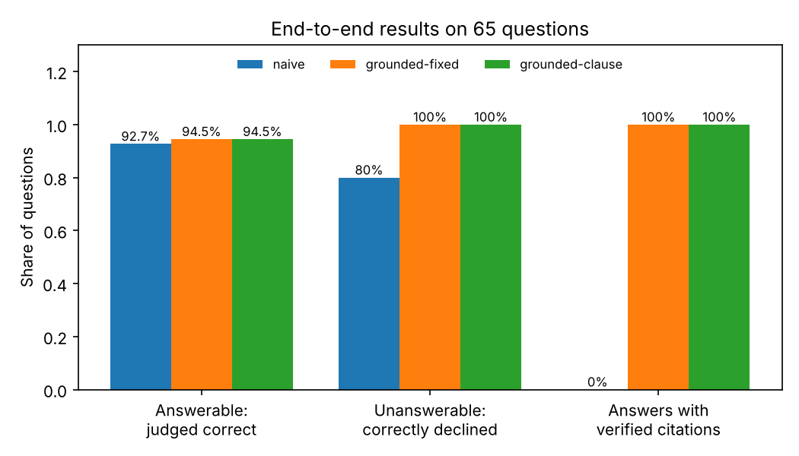
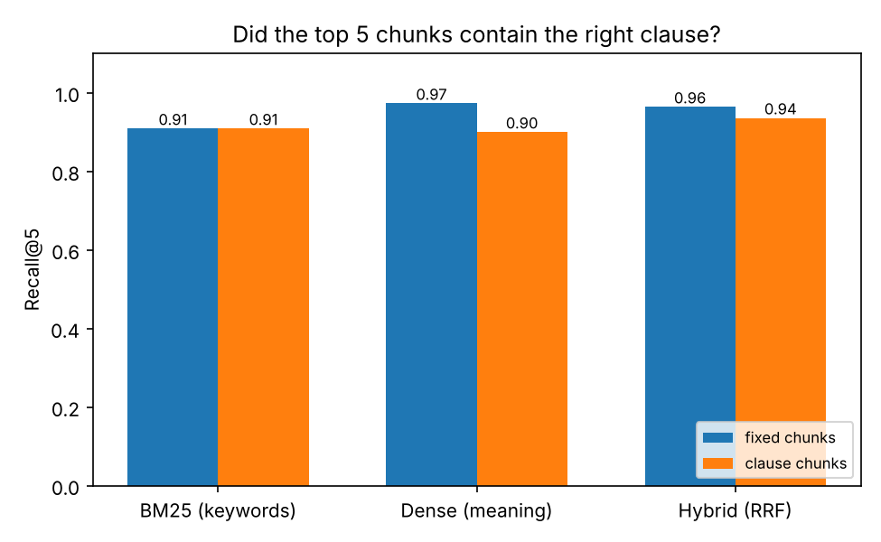
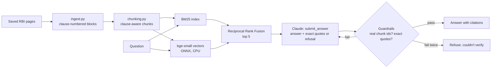

# Grounded Policy Assistant

**A question-answering assistant for RBI banking regulations that quotes the exact clause behind every answer, checks each quote against the source, and says "the documents don't cover this" instead of guessing, measured on a 65-question test set.**

Ask *"How long do I have to report an unauthorised transaction to get zero liability?"* and it answers from the 2017 RBI circular, with the quote `Within 3 working days | Zero liability` and the clause it came from. Ask about the repo rate and it declines: that isn't in its documents.

It covers three RBI documents (about 13,000 words): the 2017 circular on limiting customer liability in unauthorised electronic banking transactions, the Digital Lending Directions 2025, and the Fraud Risk Management Master Directions 2024.

---

## Results

### End to end: 65 questions (55 answerable, 10 the documents don't cover)

| | Naive RAG | Grounded, fixed chunks | **Grounded, clause chunks** |
|---|---|---|---|
| Answerable questions judged correct | 92.7% (51/55) | 94.5% (52/55) | **94.5% (52/55)** |
| Out-of-scope questions correctly declined | 80% (8/10) | 100% | **100% (10/10)** |
| Answers that went beyond the documents | 4 | **0** | **0** |
| Answers backed by a verified, exact quote | 0% | 100% | **100%** |
| Cited chunk contains the correct clause | n/a | 100% | 98% |
| Tokens per question | 2,531 | 3,544 | **2,972** |
| Seconds per question | 2.3 | 3.1 | 2.7 |



**What the grounding buys you: its mistakes are safe ones.** The naive system (same search, plain "answer from the context" prompt) gave 4 answers that went beyond its documents:
- 2 out-of-scope questions answered from general knowledge (KYC update periods, deposit-insurance limits), as if they were part of these rules.
- 2 answers padded with claims not found in the documents (one explicitly "from my recollection").

Its other 2 misses said the documents were silent when they weren't. The grounded systems never went beyond the documents: every miss (3 of 55 each) was a refusal, "the documents don't say". For a regulatory assistant, "I don't know" is an acceptable failure; a confident rule from somewhere else is not.

**Clause-aware chunking vs fixed windows: same accuracy, 16% fewer tokens, different failures.**
- The fixed-window system failed twice because a 200-word window cut a clause in half. In one case it said so itself: *"the text cuts off before the frequency"*.
- The clause-chunk system answered both of those. Its own misses were one search miss and one guardrail rejection: the answer sits in a table (flattened as `cell | cell`), and the exact-quote check rejected the citation twice, so the system refused. The likely cause is the `|` separators and spacing in table rows; reproducing and fixing it is Exercise 8.
- Both shared one miss: the question says "Fraud Monitoring Return", the document only says "FMR".

**How answers were graded.** A second model (Claude Haiku 5.5) saw the question, the *text of the correct clause* and the answer, and graded it; it never saw which system wrote the answer. Each question also lists required facts (e.g. "21 days"), checked by plain string matching. The two methods agreed on 96% of grounded answers. 55 answerable questions is a small set: one question moves accuracy by 1.8 points, so treat the 92.7% vs 94.5% difference as noise and the 0 vs 4 answers that went beyond the documents as the real result.

### Search quality (free, no API calls)

Did the top 5 chunks contain the clause that answers the question?

| Chunking | BM25 (keywords) | Dense (meaning) | Hybrid (RRF) | Words sent to the model |
|---|---|---|---|---|
| Fixed 200-word windows, 40-word overlap | 90.9% | **97.3%** | 96.4% | ~1,035 |
| Clause-aware, ≤200 words | 90.9% | 90.0% | 93.6% | **~772** |



- **Hybrid search helps most where the parts are weak.** With clause chunks it beats both keyword (+2.7 points) and meaning-based (+3.6 points) search.
- **This metric flatters fixed windows.** A window counts as "containing" a clause even if it holds only the first few words, which is exactly how the fixed system's two cut-off failures happened. The end-to-end test is the fairer comparison.

---

## How it works



1. **Ingest** (`ingest.py`): parses each RBI page into blocks tagged with their clause number (`2.1.1.2`, `10(ii)`, `Annex II`). It drops footnote markers, footnotes and tables of contents, and flattens tables to `cell | cell` rows so the liability tables stay usable.
2. **Chunk** (`chunking.py`): groups blocks by clause (`10`, `10(i)`, `10(ii)` → one chunk), capped at 200 words and split only at clause boundaries. Each chunk starts with the document name and section heading, and records which clauses it contains, which is what makes citations checkable.
3. **Search** (`retrieve.py`, `embed.py`): BM25 for exact terms, plus `bge-small-en-v1.5` embeddings (run with ONNX Runtime on CPU) for meaning, merged with Reciprocal Rank Fusion.
4. **Answer** (`answer.py`): Claude must call a `submit_answer` tool with the answer, a list of `{chunk_id, quote}` citations, and a `refused` flag. The prompt forbids outside knowledge.
5. **Verify** (`guardrails.py`): every cited id must be one of the 5 chunks shown, and every quote must appear word for word in that chunk. On failure, the model gets the specific problems and one retry; if that fails too, the system refuses rather than show an unverified answer.
6. **Evaluate** (`evaluation.py`, `answer_eval.py`): a retrieval comparison (free), then end-to-end grading of three systems on the 65-question test set (`evals/testset.yaml`).

## Quickstart

```bash
git clone https://github.com/n1ck-04/Grounded-policy-assistant-.git
cd Grounded-policy-assistant-
python -m venv .venv && source .venv/bin/activate      # Windows: .venv\Scripts\activate
pip install -e ".[dev]"
make test                    # 21 tests, no documents/model/API key needed
```

To run it for real, follow [data/README.md](data/README.md) to save the three RBI pages and download the embedding model (about 5 minutes). Then:

```bash
make ingest                  # parse the pages into clauses
make retrieval-eval          # compare chunking and search methods (free, ~20 s)
cp .env.example .env         # add your ANTHROPIC_API_KEY
make ask Q="Can a loan app read my contact list?"
make api                     # http://127.0.0.1:8000/docs
make eval                    # full evaluation: 3 systems x 65 questions (~20 min, about 1M tokens)
```

No Make on Windows? Each target is one line in the `Makefile`; run that command directly.

## Repository map

```
src/grounded/
  config.py        documents, paths, chunk sizes, top-k, model
  ingest.py        RBI page -> clause-numbered blocks
  chunking.py      fixed-window and clause-aware chunks; Chunk.covers()
  embed.py         bge-small-en-v1.5 via ONNX Runtime, with an embedding cache
  retrieve.py      BM25, dense, hybrid (RRF)
  answer.py        grounded answering loop (and the naive baseline)
  guardrails.py    citation and quote checks
  evaluation.py    test-set loading, fact matching, retrieval metrics
  answer_eval.py   end-to-end evaluation with an LLM judge
  api.py           FastAPI service
evals/testset.yaml 65 questions with gold clauses and required facts
reports/           retrieval.json, answers_*.json (every answer, grade and reason), charts
tests/             21 tests using an invented RBI-style page, a fake embedder and a fake LLM
docs/              design decisions, code walkthrough, exercises
```

## Limitations

- **Three documents.** Many RBI rules (KYC, the Ombudsman scheme) aren't covered. The Ombudsman scheme text is only published as a PDF, which RBI's server refused to download.
- **The documents aren't redistributed.** RBI's website reserves its rights, so you save the pages yourself (see data/README.md). Only short quoted facts appear in the test set.
- **A small test set.** 55 answerable questions; a one-question change moves accuracy by 1.8 points.
- **The judge is a model too.** It agreed with the deterministic fact check on 96% of grounded answers, but it hasn't been checked against human grades yet (Exercise 5).
- **Exact quotes prove the source, not the reasoning.** A verified quote shows the cited text exists; it doesn't prove the answer interprets it correctly. The judge covers that part.
- **Not legal advice.** RBI's own text is authoritative.

## Documentation

- [docs/DECISIONS.md](docs/DECISIONS.md): every major design choice, the alternatives, and why
- [docs/WALKTHROUGH.md](docs/WALKTHROUGH.md): the code explained file by file, in reading order
- [docs/EXERCISES.md](docs/EXERCISES.md): extensions to build next
